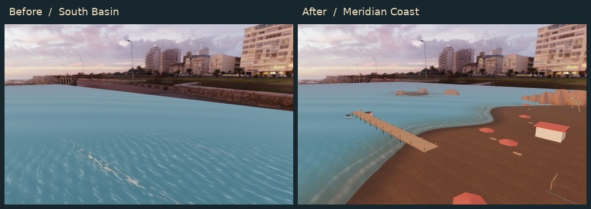

# Harborline · Meridian Coast

기준 저장소는 `asnt39/Harborline`이고, 작업 전 GitHub `main`과 Vercel 운영본은 모두 `c86f3c95cf4101c643346801e4dc42274dba9165`였어. 구현 커밋은 `e19c201`, 작업 브랜치는 `feature/harborline-coast`야. 기준 운영 배포는 Vercel의 이전 배포 목록에서 선택할 수 있어. [운영 사이트](https://harborline-six.vercel.app/) · [Vercel 프로젝트](https://vercel.com/asnt1/harborline)

## 플레이 경로

South Basin의 Mariner Street를 지나 동쪽 해안 산책로로 가. **Meridian Beach** 표지판이 있는 입구에서 모래사장으로 내려가면 돼. 기존 난간은 그 입구에서 끊기고, 양쪽에 기존 충돌 판정이 남아 있어. 해변에는 44m 선착장, 구명 시설, 파라솔과 벤치, 야자수, 작은 섬과 16개 암석이 있어. 바닷길은 남쪽 해변에서 기존 항만 바깥쪽까지 이어져.

- 바다로 걸어 들어가면 얕은 물에서 걷다가 수영으로 전환돼. 깊은 곳에서 **Space** 또는 **잠수** 버튼을 사용해. 같은 버튼으로 수면으로 돌아와. 산소가 바닥나면 주기적으로 피해를 받아.
- 선착장이나 수면에서 보트 가까이 접근해 **E**를 사용해. **W/S**로 가속·감속·후진, **A/D**로 조향, **Space**로 빠르게 감속해. 충분히 느려지면 **E**로 안전한 데크나 바다에 내려. 터치에서는 조이스틱과 기존 차량 페달을 사용해. 물에선 선착장 사다리로 올라갈 수 있어.
- **Harbor Skiff**와 **Tern Sport**는 서로 다른 선체, 흘수, 가속·최고 속도와 회전 반응을 가져. 각 보트의 설계 상한은 약 33km/h와 57km/h야. 판정은 선체 외곽과 수심을 90Hz로 검사해. 암초와 선착장에 부딪히거나 수심이 부족하면 진행이 막히고, 강한 충돌은 그 보트의 성능을 낮춰.
- 수영과 보트는 싱글플레이에서 작동해. 저장은 육지와 데크의 기존 체크포인트를 사용하고 수중·승선 상태는 기록하지 않아.

[잠수 및 산소 표시](docs/coast/diving.jpg) · [Harbor Skiff 주행](docs/coast/skiff.jpg)

## 구현과 검증

`coast-plan.js`의 해안선과 수심을 해저, 걷기, 수영, 보트가 함께 사용해. 셰이더는 수심별 색, 젖은 모래, 파도, 얕은 물의 투명도와 포말을 표현해. 캐릭터와 보트에는 기존 리그에 연결한 동작과 소량의 수면 흔적을 적용했어. 해변 발자국과 항적은 용량이 정해진 버퍼로 관리해. 보트·물보라·수중 음향은 기존 오디오 믹서의 합성음을 확장했어. 모래와 바위는 Poly Haven의 CC0 스캔을 512px WebP로 변환해 사용했어. [에셋 출처와 라이선스](public/assets/coast/CREDITS.md)

`npm ci`, `npm run build`, `node --test tests/*.mjs`를 실행했고 회귀 테스트 85개가 통과했어. 정지·회전·좌초·암초 충돌, 항만 연결, 도보 진입, 수영과 산소, 안전 하선, 구형 저장을 자동 검사했어. Linux Chromium에서는 해변에 들어가 수영·잠수하고 육지로 돌아오는 흐름과 두 보트의 승선·가속·감속·하선을 확인했어.

| 같은 카메라 / 낮음 설정 | South Basin | 해안 추가 | 보트 배치와 수면 최적화 |
| --- | ---: | ---: | ---: |
| 해안 방향 드로 콜 | 25 | 65 | 45 |
| 해안 방향 삼각형 | 34,926 | 65,356 | 65,356 |
| 해안 방향 Three.js 지오메트리·텍스처 | 45 · 103 | 58 · 109 | 65 · 109 |
| 도시 방향 드로 콜 | 52 | 58 | 59 |
| 도시 방향 삼각형 | 41,392 | 71,348 | 71,348 |

해안 방향 수치에는 새 해저와 보트·해안 시설을 포함해. 같은 재질을 사용하는 보트 메시를 합치고 낮음 설정에서 수면의 프래그먼트 노이즈를 줄였어. 수치는 Linux Chromium SwiftShader 640×400 창에서 기록했고 시민과 거리별 로딩 상태에 따라 달라져. GPU 메모리 바이트, 실제 모바일 FPS, 발열, 삼성 인터넷·갤럭시 실기기와 오디오 청음은 검증 범위 밖이야.

## 운영과 남은 범위

- **P0–P1 주요 범위**는 해안 진입, 수영, 잠수, 두 보트와 수상 충돌이야. 기후·시간별 파도, 고품질 수면 반사, 잠수 깊이 조작, 정교한 승하선·수영 애니메이션은 후속이야.
- **P2 일부**로 선착장, 사다리와 해변 시설을 배치했어. 해안 상점, 해변 교통·주차 확장, 해변 NPC, 낚시·경주와 보트 소유는 남았어.
- **P3–P7**의 전역 그래픽·캐릭터 개편, 전투·차량·경제 심화, 해양 의뢰, 날씨·음향, 온라인 해양 동기화와 모바일 실측은 후속이야.
- 기존 Render의 `/healthz`는 200이었어. 같은 서버에서 이전 배포 오리진은 WebSocket 101을 받았고, 새 Vercel 운영 오리진은 403을 받았어. Vercel 전환 전부터 남아 있는 Render 허용 오리진 문제야. 기존 Render 서비스나 환경변수는 변경하지 않았어. [운영 및 방 서버 절차](README.md)
