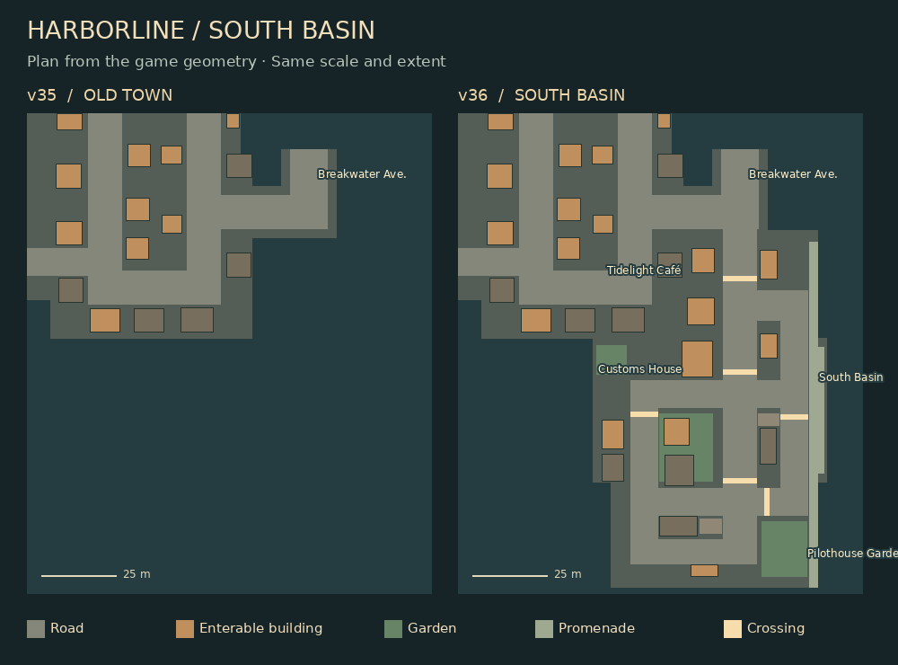

# Harborline v36 · South Basin

v35 `8abfee804ad06b1a4554b164f64d15400172c614`를 기준으로 작업했어. 복구 시 그 커밋의 Git 소스와 기존 Sites 프로젝트의 v35를 각각 사용하면 돼. 공개 주소는 [Harborline Docklands](https://harborline-docklands.asnt1.chatgpt.site/)와 [Harborline](https://harborline.asnt1.chatgpt.site/)이야.

## 플레이할 수 있는 곳

Breakwater Avenue에서 남쪽으로 내려가면 Tidelight Café와 Registry가 나와. Mariner Street는 상점·주택 사이로, Switchyard Road는 창고와 정비 시설 사이로 지나가. 동쪽 해안 산책로 끝에는 Pilothouse Garden과 전망 쉼터가 있어. 카페에서는 커피를 살 수 있고, 정원 벤치에 앉거나 기존 지도에 표시되는 안내판을 읽을 수 있어. 정원에서 발견한 신호판은 교대 수첩에 기록되고 현금 ₩650을 한 번 지급해. 발견과 현금은 기존 저장 키에서 함께 갱신돼.

지도 이미지는 실제 도로, 인도, 건물 좌표로 제작했어. 두 버전의 동일한 범위를 보여 줘.

## 설계와 호환성

- `src/south-basin-plan.js`에서 지형, 차도 폭, 필지, 주차 공간, 횡단보도, 해안 보행로를 관리해. 렌더링, 지도와 차량 충돌이 같은 도로 좌표를 사용해. 실제 입구를 갖춘 8채는 기존 실내 공간과 문 개폐 방식을 사용해.
- `src/basin-navigation.js`에서 도로 옆 보행 경로, 표시된 횡단보도와 4개 도로의 차량 순환 경로를 생성해. 문 앞과 공원 등 목적지 연결부는 직접 지정했어. 주민은 기존 길찾기와 문 시스템을, 차량은 기존 앞차 감지와 장애물 대응을 사용해.
- 해안 외곽의 난간은 플레이 영역의 실제 윤곽을 따라 생성돼. 북단 도로와 기존 도로의 이음부는 도보 및 차량 충돌 데이터에 연결돼. 건물과 도로는 거리로 표시와 그림자를 제한해. 실내 집기와 식생은 거리 기준으로 따로 로딩해. 식생은 고속 진행 방향으로 사전 요청하며 멀어지면 자체 GPU 버퍼를 해제해.
- 신규 구역은 싱글플레이에서 열려. 기존 방 서버는 Docklands 좌표 범위를 사용해. 서버와 저장 키는 기존 형식을 사용하고, 저장에 새 발견 목록이 없으면 빈 목록으로 읽어.
- 지형은 Harborline을 위해 새로 배치했어. 공공 산책로가 산업·항구 도시와 만나는 방식과 해안 구역의 개성을 참고했어. OSM의 가공·배포 조건을 검토했고, 이번 빌드에는 OSM 지도 데이터를 쓰지 않았어. [볼티모어 수변 보행로 기준](https://codes.baltimorecity.gov/us/md/cities/baltimore/code/32/12-906) · [마이애미 수변 설계 지침](https://www.miamidda.com/Urban-Planning/Urban-Design/Baywalk-Riverwalk-Waterfront-Design-Guidelines) · [Rockstar 공식 Leonida Keys 소개](https://www.rockstargames.com/VI/only-in-leonida/leonida-keys) · [OSMF Produced Work 지침](https://osmfoundation.org/wiki/Licence/Community_Guidelines/Produced_Work_-_Guideline)
- 기존 Poly Haven CC0 도로·포장·잔디·건축 재질과 Tree Small 02 식생 아틀라스를 재사용했어. 새 소품은 게임 코드에서 만든 기하를 사용해. 신규 외부 음원, 모델 파일, 핵심 의존성 추가 없이 빌드돼. [도로와 나무](public/assets/street/CREDITS.md) · [잔디](public/assets/estuary/CREDITS.md) · [건축 재질](public/assets/architecture/CREDITS.md)

## v35와 비교

| 항목 | v35 | v36 |
| --- | ---: | ---: |
| 전체 건물 | 68 | 80 |
| 진입 가능 건물 | 32 (47.1%) | 40 (50.0%) |
| 주민 및 경찰 | 22 (시민 13) | 25 (시민 16) |
| 신규 구역 시민 차량 | 0 | 근거리 최대 데스크톱 2대, 터치 1대 |
| 연결된 도보 샘플 | 128,038 | 154,597 |
| 정적 메시 및 배치 수 | 322 | 355 |
| 정적 삼각형 | 250,756 | 267,026 |
| 정적 지오메트리 배열 | 16.42 MiB | 17.83 MiB |
| Node 힙 중앙값 | 15.98 MiB | 17.19 MiB |

추가 육지의 평면 면적은 7,815m²야. 신규 도로 7개 중심선의 합은 435.5m야. 동일한 0.5m 간격에서 실제 도시 충돌을 사용해 Breakwater Avenue부터 연결된 샘플을 세었어. 도보 샘플 증가분은 약 6,640m²에 해당해. 정적 비용은 같은 로더와 장면을 사용한 Node 검사에서 3회 측정했어. 텍스처는 대역 객체를 사용했고, 표의 메시 수는 실제 프레임의 드로 콜이 아니야.

`npm run build`와 `node --test tests/*.mjs`로 검증해. 새 도로를 자동차와 오토바이로 주행하고, 시민 차량 두 대를 실제 충돌체 위에서 90초간 순환시켰어. 새 건물의 문, 입장 및 퇴장, 주민의 실내 방문, 외부 시설 접근, 새 발견 보상의 중복 방지와 구형 저장을 검사했어. 남서쪽 연석에서 차량 앞부분이 걸리고 뒤차까지 멈추던 문제는 순환로의 차선 오프셋을 1.65m에서 1.15m로 좁혀 해결했어. Sites 미리보기 포트 연결이 실패했고 클라우드 브라우저도 열리지 않아 3D 전후 스크린샷, 실제 드로 콜·FPS·프레임타임·GPU 메모리와 실기기 조작성은 확인하지 못했어. 온라인 방 테스트는 자동 회귀 테스트 범위야.

## 다음 단계

- **Phase 0 기반 구현** · 신규 구역에 공통 도로 데이터, 보행·차량 경로 생성과 거리 기반 로딩을 적용했어. 기존 도시의 경로 데이터 통합과 고속 이동의 모바일 실측은 남았어.
- **Phase 1 첫 구역 구현** · 상업 가로, 주거 블록, 항만 작업 구역, 해안 공원과 8개 실내를 추가했어. 구시가지 전체, 고층 도심, 교외 및 광역 도로망은 남았어.
- **Phase 2 일부 구현** · 시민 3명의 일과와 순환 교통을 추가했어. 신호 제어, 돌발 이벤트, 날씨에 따른 행동, 평판 및 응급 대응은 남았어.
- **Phase 3–8 미완료** · 숨은 발견의 단일 보상은 구현했어. 직업과 경제 확장, 차량·부동산 소유, 스마트폰, 경주, 수상과 항공 활동, 신규 스토리, 종합 모바일 검증은 별도 작업이야.
