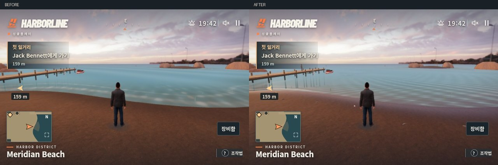

# Harborline · Urban & Coastal Remaster

기준 및 복구 지점은 GitHub `main`과 Vercel 운영본이 일치한 `128d53cd7e199a61878bc5d3f7cbd50f490b7112`다. 작업 브랜치는 `feature/harborline-urban-coastal-remaster`이며 운영 프로젝트는 기존 [asnt1/harborline](https://vercel.com/asnt1/harborline)이다.

[수중 전후](urban-coastal/underwater.jpg) · [South Basin 전후](urban-coastal/skyline.jpg) · [Cooper House 2층](urban-coastal/cooper-loft.jpg)

## 플레이와 변경점

- **Meridian Coast:** South Basin 해안 입구에서 계속 걸으면 얕은 파도와 젖은 모래, 기존 수영 전환이 이어진다. 깊어지면 Space로 잠수한다. 수면과 부력은 기존의 공유 파도 계수를 쓴다. 낮음은 한 방향의 미분 텍스처와 하늘 근사색, 높음은 방향과 속도가 다른 두 번째 노멀 샘플과 기존 HDR 하늘을 사용한다. 두 설정 모두 Fresnel, 수심별 투명도, 해안 포말과 배치된 바위·선착장 반응이 있다. 물속에는 깊이에 따른 안개와 바닥 빛무늬를, 수영과 보트에는 서로 다른 폭의 항적을 적용했다.
- **모래와 시설:** 기존 색과 노멀에 Sand 02 거칠기 맵을 추가하고 물가 반사와 젖은 색을 섞었다. 마른 지역에만 낮은 모래 언덕을 넣어 수심·수영 진입·부력 판정은 그대로 유지했다. 접힌 천 형태의 파라솔, 구조대 오두막의 지붕·셔터, 작은 돌과 유목을 배치했다. Sand 02는 Charlotte Baglioni/Poly Haven의 CC0 원본을 512px WebP로 변환했다. [해안 에셋 출처](../public/assets/coast/CREDITS.md)
- **도시:** 기존 도로와 인도 경계를 유지하면서 Docklands, Old Town, West Bank, South Basin과 항구 도로의 아스팔트·포장 재질 및 미터당 텍스처 축척을 공유한다. South Basin에 배수구를 추가했다. Registry 오피스, Basin Court 주거동, Mariner Supply 상업 복합동의 상부를 확장했다. 높이는 각각 약 33, 34, 22m이며 기존 거리 출입구와 충돌 범위를 유지했다. 타워 상부는 외관이다.
- **Cooper House:** South Basin의 기존 문으로 들어가 오른쪽 계단을 이용한다. 거실·간이 주방과 침실로 쓰는 진입 가능한 두 층, 실제 바닥과 천장, 상부 난간 및 가구 충돌이 있다. 2층 바닥 높이는 2.73m다.
- **시민:** 16명에서 32명으로 늘었다. 경찰 9명은 그대로다. 부두와 시장 4명, Old Town 3명, West Bank 3명, South Basin 2명, 해변과 선착장 4명이 추가됐다. 목적지 예약과 경로 캐시를 쓰며, 자리가 넓은 지정 지점에서는 둘이 잠깐 대화하고 고개를 끄덕인다. 차량이나 플레이어가 접근하거나 한 명이 행동 불능이면 양쪽 대화가 함께 끝난다. 프러스텀 밖 인물은 저빈도로 갱신하며, 같은 인물의 메시들은 바인드 포즈가 같을 때 본 텍스처를 공유한다.

## 교통 재현

수정 전에는 차량 중심을 기준으로 출구 장애물을 가려 맞은편 정차선의 차량도 출구를 막는 것으로 판단했다. 독립적인 후진 타이머는 정상 대기 중인 뒤차까지 후진시켰다. 회차 지점에는 진입 순서가 없어 앞차가 출차하기 전에 뒤차도 들어갔다.

출구는 회전 뒤 차체 방향과 크기로 검사한다. 교차로와 회차 지점에는 대기시간을 반영한 통행권이 있고, 진입 전에 출구가 막히면 가능한 다른 분기를 택한다. 차선상의 단순 추종 정차와 실제 차체 진행 실패를 분리하고, 순환 대기 또는 진행 실패가 발생했을 때 뒤쪽 여유를 검사해 한 대만 후진시킨다. 보이는 차량의 위치를 순간 변경하거나 교체하지 않는다.

135초씩 4대/8대, Docklands 일반·서쪽 출구 장애물·북쪽 출구 장애물 및 Basin 일반·회전부 장애물의 10개 조합을 실행했다. 장애물은 28초에 제거하고 33초 이후 정차를 집계했다.

| 대표 조건 | 수정 전 가장 긴 정차 | 수정 후 가장 긴 정차 |
| --- | ---: | ---: |
| Docklands 4대 일반 | 12.3초 | 3.3초 |
| Docklands 4대 서쪽 출구 장애물 | 15.5초 | 3.4초 |
| Docklands 8대 일반 | 102초 이상 | 17.0초 |
| Docklands 8대 서쪽 출구 장애물 | 102초 이상 | 13.9초 |
| Docklands 8대 북쪽 출구 장애물 | 102초 이상 | 16.9초 |
| Basin 8대 회전부 장애물 | 0.6초 | 0초 |

모든 수정 후 조합에서 동시 후진 0프레임이었다. 회귀 테스트는 정차 20초 미만, 차체 겹침 없음, 카메라 안 차량 교체 없음을 확인한다. 도시 전체 목적지·주차·시간대별 교통량을 하나의 차선 그래프로 경로 탐색하는 작업은 남아 있다.

## 검증과 한계

`npm ci`, `npm run build`, `node --test tests/*.mjs`로 확인했다. 자동 테스트 87개는 계단 왕복과 난간, 시민의 이동·대화와 통행 공간, 수영·산소·보트 충돌, 저장·차량·경찰·미션·장비·설치 메타데이터를 포함한다. Chromium에서 같은 좌표와 낮음 설정으로 전후 화면을 캡처하고 잠수와 계단 진입을 확인했다.

| 640×400 Chromium SwiftShader | 드로 콜 전 → 후 | 삼각형 전 → 후 | 텍스처 수 전 → 후 | p50 / p95 전 → 후 |
| --- | ---: | ---: | ---: | ---: |
| Meridian Beach | 34 → 41 | 56,264 → 67,820 | 99 → 78 | 317 / 383 → 600 / 783 ms |
| Docklands | 208 → 201 | 250,108 → 230,599 | 129 → 107 | 1,683 / 2,450 → 883 / 2,300 ms |

소프트웨어 렌더링의 짧은 표본이며 실기기 FPS나 GPU 메모리 바이트를 의미하지 않는다. 해변 표본의 프레임타임은 증가했다. 실제 갤럭시·삼성 인터넷 성능과 긴 플레이, 오디오 청음, 구역별 실측 인구 밀도는 후속 검증이다. 전 구역의 도로 선형 재설계, 엘리베이터·추가 주거층, 시민의 시간대별 생활과 다층 이동, 본격적인 해양 생물과 해안 상점은 이번 범위에서 완료하지 못했다. 기존 Render 방 서버의 상태·Vercel 오리진 요청은 이 환경에서 정상 응답을 확인하지 못했다. 서버와 허용 오리진은 변경하지 않았다.
